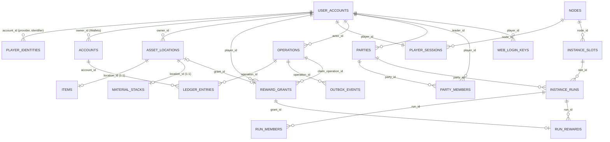

# Dimensional Miner — Database Schema Reference

> สถาปัตยกรรมแบ่งออกเป็น **2 Database อิสระขาดจากกัน** ใน PostgreSQL 16+:
> 1. **`dimensional_content`**: ดูแล Master Definitions ของเกม (Items, Weapons, Recipes, Loot Tables, Dungeons, Upgrades)
> 2. **`dimensional_game`**: ดูแล Server Runtime State (Accounts, Identities, Inventory, Economy, Parties, Instances, Web Auth)

---

## 1. ปรัชญาพื้นฐานและการแยกสถาปัตยกรรม

- **Dual-Database Decoupling**: ข้อมูล Runtime ของผู้เล่นในเกม (เช่น การขุดดิน เก็บหิน ไม้ ในกระเป๋า) จะ **ไม่มีวันวิ่งไปแตะต้องหรือเจือปน** ในฐานข้อมูล Content Master เด็ดขาด
- **Identity Decoupling**: ระบบไม่ได้ผูกติดกับ Minecraft UUID เป็น ID หลัก แต่มี **`user_accounts`** เป็น Core Identity และเชื่อมโยงผ่าน **`player_identities`** (รองรับ `MINECRAFT`, `DISCORD`, `WEB`)
- **Authoritative State**: ฐานข้อมูลเป็น authoritative สำหรับทรัพย์สินทั้งหมด ส่วน `ItemStack` ใน Minecraft เป็นเพียง **projection** ชั่วคราว
- **Idempotent Operations**: รายการเงิน/ของ ทุกอย่างบันทึกผ่าน `operations` เพื่อป้องกัน double-action / double-spend
- **Atomic Outbox**: ทุกการเปลี่ยนแปลงส่งต่อผ่าน `outbox_events` ใน Transaction เดียวกัน

---

## 2. ภาพรวมกลุ่มโดเมนใน 2 ฐานข้อมูล

### ก. dimensional_content (Content Master Database)

| กลุ่ม | ตาราง | หน้าที่ |
|---|---|---|
| Content Definitions | `content_definitions` | Master Registry ของ ItemBase, Recipe, LootTable, Dungeon, PassiveGenerator, UpgradeTree (Versioned & Immutable) |
| Releases | `content_releases` | Snapshot ประวัติการ Export Master Content เข้าสู่เซิร์ฟเวอร์ |

### ข. dimensional_game (Server Runtime Database)

| กลุ่ม | ตาราง | หน้าที่ |
|---|---|---|
| Identity & Account | `user_accounts`, `player_identities`, `players (view)` | บัญชีผู้ใช้กลาง และการผูกตัวตนภายนอก (Minecraft UUID) |
| Session & Node | `nodes`, `player_sessions`, `transfers` | Topology backend, session fencing, handoff ข้าม node |
| Economy | `accounts`, `ledger_entries` | Wallets (COIN/ENERGY) แบบ double-entry |
| Inventory/Assets | `asset_locations`, `items`, `material_stacks` | ช่องกระเป๋าและไอเทมในตัวผู้เล่น (Decoupled จาก Content DB) |
| Party System | `parties`, `party_members` | กลุ่มปาร์ตี้และการจำกัดการแก้ไขปาร์ตี้ขณะอยู่ในดันเจี้ยน |
| Instance & Dungeon | `instance_slots`, `instance_runs`, `run_members`, `run_rewards` | โครงสร้างอินสแตนซ์รัน การจองสล็อต และสิทธิ์รางวัล |
| Web Auth & Shop | `web_login_keys`, `server_shop_products` | รหัส OTP Login เข้า Web Console และรายการแพ็กเกจสินค้าใน Web Shop |
| Grants/Mailbox | `reward_grants`, `reward_claim_scopes` | ตู้จดหมายรับของรางวัลจาก Web Shop, บอส หรือดันเจี้ยน |
| Progression | `player_unlocks`, `quest_progress` | ความคืบหน้าเควสต์และระดับการปลดล็อก |
| Mining & World | `mine_nodes`, `world_encounters`, `encounter_contributions` | โหนดแร่เกิดใหม่ และ World Boss |
| Workspace & Market | `workspaces`, `workspace_generators`, `processing_jobs`, `market_listings` | เวิร์กช็อปส่วนตัว และตลาดกลางประมูล |
| Transactions | `operations`, `outbox_events`, `processed_events`, `audit_log` | บันทึกคำสั่งและ Event Outbox |

---

## 3. ER Diagram



---

## 4. รายละเอียดโครงสร้างตาราง Content (dimensional_content)

### `content_definitions` — Master Registry
| คอลัมน์ | ประเภท | ข้อจำกัด | คำอธิบาย |
|---|---|---|---|
| `definition_id` | text | PK(ร่วม version) | รหัสคงที่ เช่น `prim_metal`, `dungeon_ancient_ruins_t0` |
| `version` | integer | PK(ร่วม definition_id), CK > 0 | เลขเวอร์ชันของนิยามคอนเทนต์ (Immutable) |
| `kind` | text | NOT NULL | `ItemBase`, `Recipe`, `LootTable`, `Dungeon`, `PassiveGenerator`, `UpgradeTree` |
| `payload` | jsonb | NOT NULL | โครงสร้างคอนเทนต์ทั้งหมด |
| `checksum` | text | NOT NULL | SHA-256 Hash ของ Payload |
| `published_at` | timestamptz | DEFAULT now() | วันเวลาที่เผยแพร่ |

#### โครงสร้าง Payload ชนิด `Dungeon`:
```json
{
  "display_name": "Ancient Void Ruins",
  "description": "Forgotten underground ruins guarded by void creatures.",
  "template_map": "ind_t0",
  "required_level": 1,
  "time_limit_seconds": 900,
  "max_players": 4,
  "steps": [
    {
      "step_id": "step_1_clear_guards",
      "name": "Clear the Outer Gate",
      "goal": {
        "type": "INTERACT_DUMMY",
        "dummy_id": "crystal_switch_1",
        "display_text": "Slay Void Crawlers",
        "target_count": 5,
        "target_mob_id": "void_crawler",
        "duration_seconds": 0
      },
      "on_start": [
        {
          "name": "SwitchA",
          "action": "SPAWN_DUMMY",
          "amount": 3,
          "center": { "x": 0, "y": 64, "z": 0 },
          "mob_id": "void_crawler",
          "radius": 5,
          "dummy_id": "crystal_switch_1",
          "vanilla_type": "ZOMBIE"
        }
      ],
      "on_current": null,
      "on_end": []
    }
  ],
  "final_rewards": {
    "guaranteed": [
      { "qty": 2, "item": "prim_metal" },
      { "amount": 1000, "currency": "COIN" }
    ]
  }
}
```

---

## 5. รายละเอียดตาราง Runtime (dimensional_game)

### ก. Identity & Accounts
- **`user_accounts`**:
  - `account_id` (UUID, PK): รหัสบัญชีผู้ใช้หลัก
  - `username` (TEXT, NOT NULL): ชื่อผู้ใช้
  - `status` (TEXT): `ACTIVE`, `QUARANTINED`, `BANNED`
- **`player_identities`**:
  - `identity_id` (UUID, PK)
  - `account_id` (UUID, FK → user_accounts)
  - `provider` (TEXT): `MINECRAFT`, `DISCORD`, `WEB`, `CUSTOM`
  - `identifier` (TEXT): เช่น Minecraft UUID (Unique ต่อ Provider)
- **`players` (View)**: View สะดวกสำหรับดู `account_id` คู่กับ `minecraft_uuid`

### ข. Party & Instance Dungeon System
- **`parties`**:
  - `party_id` (UUID, PK): รหัสกลุ่มปาร์ตี้
  - `leader_id` (UUID, FK → user_accounts): หัวหน้าปาร์ตี้
  - `state` (TEXT): `OPEN`, `LOCKED`, `DISBANDED`
- **`party_members`**:
  - `party_id` (UUID, FK → parties)
  - `player_id` (UUID, FK → user_accounts, Unique)
  - `ready` (BOOLEAN): สถานะความพร้อม
- **`instance_slots`**:
  - `slot_id` (UUID, PK)
  - `node_id` (TEXT, FK → nodes)
  - `template_id` / `template_version` (TEXT, INTEGER)
  - `world_key` (TEXT): ชื่อคีย์อ้างอิงเวิลด์
  - `state` (TEXT): `WARM`, `RESERVED`, `ACTIVE`, `CLEANING`, `QUARANTINED`
- **`instance_runs`**:
  - `run_id` (UUID, PK)
  - `requester_id` (UUID, FK → user_accounts)
  - `party_id` (UUID, FK → parties)
  - `slot_id` (UUID, FK → instance_slots)
  - `state` (TEXT): `REQUESTED`, `RESERVED`, `LOADING`, `READY`, `ACTIVE`, `SUCCEEDED`, `FAILED`, `RETURNING`, `CLEANING`, `CLOSED`
  - `outcome` (TEXT): `SUCCEEDED`, `FAILED`, `ABORTED`
- **`run_members`**:
  - `run_id` (UUID, FK → instance_runs)
  - `player_id` (UUID, FK → user_accounts)
  - `eligible` (BOOLEAN): สิทธิ์ได้รับของรางวัลเมื่อจบดันเจี้ยน
- **`run_rewards`**:
  - `run_id` (UUID, FK → instance_runs)
  - `player_id` (UUID, FK → user_accounts)
  - `reward_slot` (TEXT)
  - `grant_id` (UUID, Unique, FK → reward_grants)

### ค. Web Authentication & Shop
- **`web_login_keys`**:
  - `key_code` (TEXT, PK): รหัสผ่านตัวเลข/ตัวอักษร 6 หลัก สร้างจาก `/weblogin`
  - `player_id` (UUID, FK → user_accounts): เจ้าของรหัส
  - `created_at` (TIMESTAMPTZ): เวลาที่สร้าง
  - `expires_at` (TIMESTAMPTZ): เวลาหมดอายุ (5 นาที)
  - `used_at` (TIMESTAMPTZ): เวลาที่นำไปล็อกอินสำเร็จ
- **`server_shop_products`**:
  - `product_id` (UUID, PK): รหัสแพ็กเกจสินค้า
  - `name` (TEXT): ชื่อสินค้า
  - `description` (TEXT): รายละเอียดสินค้า
  - `price_coin` (BIGINT): ราคาขายเป็น COIN ในเกม
  - `items` (JSONB): รายการไอเทมในแพ็กเกจ เช่น `[{"item": "thing_sword", "qty": 1}]`
  - `is_active` (BOOLEAN): เปิดแสดงผลบนหน้า Web Shop หรือไม่
- **`reward_grants` (Mailbox)**:
  - `grant_id` (UUID, PK)
  - `player_id` (UUID, FK → user_accounts)
  - `source_key` (TEXT, Unique): ป้องกันการแจกซ้ำ เช่น `dungeon_reward:<sessionId>:<playerId>` หรือ `shop_purchase:<opId>`
  - `payload` (JSONB): รายการของรางวัล (`items`, `currency`)
  - `state` (TEXT): `AVAILABLE`, `CLAIMED`, `QUARANTINED`

### ง. Economy & Double-Entry Ledger
- **`accounts`**:
  - `account_id` (UUID, PK)
  - `owner_id` (UUID, FK → user_accounts)
  - `currency` (TEXT): `COIN`, `ENERGY`, `SERVER_XP`
  - `balance` (BIGINT): ยอดเงินคงเหลือ (ห้ามติดลบ)
- **`ledger_entries`**:
  - `entry_id` (UUID, PK)
  - `operation_id` (UUID, FK → operations)
  - `account_id` (UUID, FK → accounts)
  - `delta` (BIGINT): จำนวนที่เพิ่ม (+) หรือหัก (-)
  - `reason` (TEXT): เหตุผล เช่น `DUNGEON_CLEAR_REWARD`, `SHOP_BUY`

### จ. Inventory & Assets
- **`asset_locations`**:
  - `location_id` (UUID, PK)
  - `owner_id` (UUID, FK → user_accounts)
  - `kind` (TEXT): `INVENTORY`, `EQUIPPED`, `STASH`, `MARKET_ESCROW`, `GRANT`, `DESTROYED`
  - `slot` (INTEGER): ช่องเก็บในกระเป๋า (0–35)
  - `container_key` (TEXT): เช่น `MAIN_INVENTORY`
- **`items`**:
  - `item_id` (UUID, PK)
  - `location_id` (UUID, 1:1 Unique, FK → asset_locations)
  - `definition_id` (TEXT)
  - `rarity` (TEXT)
  - `advancement` (0–100), `refine` (0–10), `durability`
- **`material_stacks`**:
  - `stack_id` (UUID, PK)
  - `location_id` (UUID, 1:1 Unique, FK → asset_locations)
  - `definition_id` (TEXT)
  - `quantity` (BIGINT, > 0)