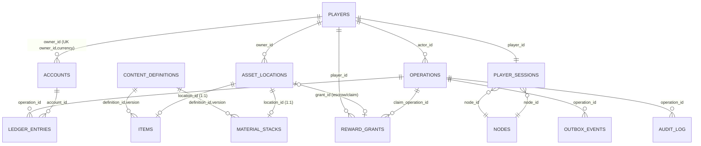

# Dimensional Miner — Database Schema Reference

> อ้างอิงจาก `docs/schema.sql` (PostgreSQL 16 DDL baseline, 31 ตาราง)
> สถานะ: นำไป apply จริงบน PostgreSQL 16 แล้ว (ใช้กับ plugin + web ใน repo นี้)

## ปรัชญาพื้นฐาน

- **ฐานข้อมูลเป็น authoritative** สำหรับทรัพย์สิน custom ทั้งหมด — ไอเทม custom, stack, กระเป๋าเงิน (Coin/Energy),
  logical inventory slot และ progression ส่วน `ItemStack` ใน Minecraft เป็นเพียง **projection** ที่สร้างใหม่ได้
- **รายการเงิน/ของ** ทุกบาทเปลี่ยนต้องผ่าน `operations` (idempotency) เหมือนกันทุกรายการ
  และหลายคำสั่งต้องไม่ทำให้ effect ที่ถูกต้องเกิดเกิน 1 ครั้งต่อ key
- **ทุก updates สำคัญ** ฝาก `outbox_events` ใน transaction เดียว เพื่อให้ consumer (เช่น web, worker) เห็นแบบ atomic
- **Timestamp เป็น UTC** (`timestamptz`) • `amount/balance` เป็น **integer** เสมอ (หลีกเลี่ยง float drift)

## สัญลักษณ์ที่ใช้

| เครื่องหมาย | ความหมาย |
|---|---|
| `PK` | Primary Key |
| `FK → table(col)` | Foreign Key |
| `UK(...)` | Unique constraint |
| `IX` | Index (บางตัวเป็น partial) |
| `CK` | Check constraint (รวม invariant)**

ค่าที่เป็น enum ถูกบังคับด้วย `CHECK (... IN (...))` ใน DDL

---

## ภาพรวม — กลุ่มโดเมน

| กลุ่ม | ตาราง | หน้าที่ |
|---|---|---|
| Session & Node | `players`, `nodes`, `player_sessions`, `transfers` | บัญชีผู้เล่น, topology backend, session fencing, handoff ข้าม node |
| Content | `content_definitions` | registry ของ definition ที่ version ระบุ |
| Economy | `accounts`, `ledger_entries` | wallet (COIN/ENERGY/SERVER_XP) แบบ double-entry |
| Inventory/Assets | `asset_locations`, `items`, `material_stacks` | canonical location ของทรัพย์สินทั้งหมด |
| Grants/Mailbox | `reward_grants`, `reward_claim_scopes` | รางวัล durable, invocative mailbox, quota ข้าม channel |
| Progression | `player_unlocks`, `quest_progress` | unlock + quest milestones |
| Mining | `mine_nodes` | node แร่ + generation + respawn |
| Party | `parties`, `party_members` | กลุ่ม 1–4 คน |
| Instance | `instance_slots`, `instance_runs`, `run_members`, `run_rewards` | dungeon run lifecycle + rewards |
| World Boss | `world_encounters`, `encounter_contributions` | encounter ต่อ channel + contribution |
| Workspace | `workspaces`, `workspace_acl`, `processing_jobs` | พื้นที่ส่วนตัว, ACL, jobs แปรรูป |
| Market | `market_listings` | AH fixed-price + escrow |
| Transactions/Messaging | `operations`, `outbox_events`, `processed_events`, `audit_log` | command log, outbox, dedup consumer, audit trail |

---

## ER Diagram (โดเมนหลัก: player/session/inventory/economy)

(ตาราง mining/instance/workspace/market มี relation อยู่ในส่วนรายละเอียดด้านล่าง)

---

# รายละเอียดรายตาราง

## 1. Session & Node

### players — บัญชีผู้เล่น

| คอลัมน์ | ประเภท | ข้อจำกัด | คำอธิบาย |
|---|---|---|---|
| player_id | uuid | PK | UUID ของ players (Minecraft UUID) |
| username | text | NOT NULL | ชื่อปัจจุบัน (update ได้) |
| created_at | timestamptz | DEFAULT now() | เวลาสร้าง |
| status | text | DEFAULT 'ACTIVE', CK IN (ACTIVE, QUARANTINED, BANNED) | สถานะบัญชี |

Relations: 1:N → `player_sessions`, `accounts`, `asset_locations`, `items/stacks` (ผ่าน location),
`reward_grants`, `operations`, `quest_progress`, `player_unlocks`, `parties`(leader), `memberships` ฯลฯ

### nodes — topology backend

| คอลัมน์ | ประเภท | ข้อจำกัด | คำอธิบาย |
|---|---|---|---|
| node_id | text | PK | ชื่อ node (เช่น `main-a`, `instance-b`) |
| role | text | CK IN (MAIN, INSTANCE, PROXY, WORKSPACE) | บทบาทที่รัน |
| status | text | CK IN (READY, DRAINING, OFFLINE) | สถานะให้บริการ |
| heartbeat_at | timestamptz | NOT NULL | ตัวบอกว่ายังมีชีวิต |
| capacity | jsonb | DEFAULT '{}' | ข้อมูลความจุ/load |

### player_sessions — เซสชัน + **epoch fencing**

| คอลัมน์ | ประเภท | ข้อจำกัด | คำอธิบาย |
|---|---|---|---|
| player_id | uuid | PK, FK → players | หนึ่งผู้เล่นหนึ่งแถว |
| node_id | text | FK → nodes | node ที่ถือสิทธิ์เขียน |
| epoch | bigint | CK > 0 | **เพิ่มทุกครั้งที่เขียน** — ใช้กัน writer เก่าเขียนทับ |
| state | text | CK IN (ACTIVE, FROZEN, TRANSFERRING, OFFLINE) | สถานะเซสชัน |
| lease_until | timestamptz | NOT NULL | lease ตามเวลา DB (ไม่ใช่เวลา game node) |
| snapshot_version | bigint | DEFAULT 0 | version ของ snapshot/logical state ผู้เล่น |

Invariant: **I5** — ณ เวลาหนึ่งมี writer backend เพียงรายเดียวต่อผู้เล่นที่ถือ epoch ถูกต้อง
ทุก write ต้อง lock แถวนี้ (`SELECT ... FOR UPDATE`) และตรวจ lease/epoch ก่อน commit

### transfers — handoff ข้าม node

| คอลัมน์ | ประเภท | ข้อจำกัด | คำอธิบาย |
|---|---|---|---|
| transfer_id | uuid | PK | |
| player_id | uuid | FK → players | |
| source_node | text | FK → nodes | node เดิม |
| destination_node | text | FK → nodes | node ปลายทาง |
| source_epoch | bigint | NOT NULL | ค่า epoch ก่อนโอน (CAS ล่าสุด) |
| token_hash | text | UK | แค่ **hash** ของ one-time token ไม่เก็บ token เปล่า |
| state | text | CK IN (PREPARED, ACCEPTED, ACKED, CANCELLED, EXPIRED) | state machine |
| expires_at | timestamptz | NOT NULL | token หมดอายุ |
| accepted_epoch | bigint | | epoch ใหม่ฝั่ง destination |
| operation_id | uuid | FK → operations | operation ที่สร้าง transfer |

Unique partial: `one_open_transfer(player_id) WHERE state IN ('PREPARED','ACCEPTED')`
→ ผู้เล่นมี transfer ที่ค้างอยู่ได้แค่หนึ่งราย

---

## 2. Content

### content_definitions — content registry (immutable, versioned)

| คอลัมน์ | ประเภท | ข้อจำกัด | คำอธิบาย |
|---|---|---|---|
| definition_id | text | PK(ร่วม version) | ID คงที่ เช่น `crystal_fragment`, `iron_sword` |
| version | integer | PK(ร่วม definition_id), CK > 0 | publish แบบ immutable |
| kind | text | NOT NULL | เช่น MATERIAL, ITEM, RECIPE, AFFIX, BOSS, LOOT_TABLE |
| payload | jsonb | NOT NULL | ข้อมูล content (display, stats, ฯลฯ) |
| checksum | text | NOT NULL | เช็คซัมของ payload |
| published_at | timestamptz | DEFAULT now() | |

Note: `items`/`material_stacks`/`mine_nodes`(ore)/`processing_jobs`(recipe) อ้าง relation
`(definition_id, definition_version)` → รัน/job/quote ต้อง **pin version** ตั้งแต่เริ่ม

---

## 3. Economy

### accounts — กระเป๋าเงิน

| คอลัมน์ | ประเภท | ข้อจำกัด | คำอธิบาย |
|---|---|---|---|
| account_id | uuid | PK | |
| owner_id | uuid | FK → players | NULL เมื่อเป็น system account |
| system_code | text | | เมื่อเป็น system (source/sink) |
| currency | text | CK IN (COIN, ENERGY, SERVER_XP) | |
| balance | bigint | DEFAULT 0, CK (owner NULL OR balance>=0) | เงินจริง (integer) |
| version | bigint | DEFAULT 0 | optimistic lock |

Constraints:
- `UK(owner_id, currency)` — หนึ่งผู้เล่นหนึ่งบัญชีต่อสกุล
- `UK(system_code, currency)`
- `CK(owner_id IS NULL XOR system_code IS NULL)` — ต้องเป็น player account หรือ system account อย่างใดอย่างหนึ่ง

Invariant: **I2, I10** — balance ห้ามติดลบ (player) และยอดรวมทุก currency ต้องสมดุลรวม system accounts
**ห้ามแก้ balance ตรง ๆ โดยไม่มี `ledger_entries` ใน transaction เดียว**

### ledger_entries — double-entry

| คอลัมน์ | ประเภท | ข้อจำกัด | คำอธิบาย |
|---|---|---|---|
| entry_id | uuid | PK | |
| operation_id | uuid | FK → operations | operation ต้นเหตุ |
| account_id | uuid | FK → accounts | |
| delta | bigint | CK <> 0 | บวก/ลบ |
| reason | text | NOT NULL | เช่น MARKET_BUY, REPAIR_FEE |
| created_at | timestamptz | DEFAULT now() | |

`IX ledger_account_time(account_id, created_at)`

---

## 4. Inventory & Assets

### asset_locations — canonical location ของทรัพย์สินทั้งหมด

| คอลัมน์ | ประเภท | ข้อจำกัด | คำอธิบาย |
|---|---|---|---|
| location_id | uuid | PK | หนึ่ง location ต่อหนึ่ง item/stack |
| owner_id | uuid | FK → players | เจ้าของ |
| kind | text | CK IN (INVENTORY, EQUIPPED, STASH, MARKET_ESCROW, JOB_ESCROW, GRANT, DESTROYED) | อยู่ที่ไหน |
| asset_kind | text | CK IN (ITEM, STACK) | ไอเทม single หรือ stack |
| container_key | text | | เช่น 'inv', 'HELMET', ชื่อ stash |
| slot | integer | CK >= 0 | slot ใน container |
| grant_id | uuid | FK → reward_grants | เฉพาะ kind=GRANT |
| version | bigint | DEFAULT 0 | optimistic lock |

Constraints สำคัญ:
- `UK occupied_slot(owner_id, container_key, slot) WHERE slot IS NOT NULL` → **กันไอเทมสองรายการทับ slot เดียว**
- `CK((kind IN (INVENTORY,EQUIPPED,STASH)) = (slot IS NOT NULL))`
- `CK(slot IS NULL OR container_key IS NOT NULL)`
- `CK((kind='GRANT') = (grant_id IS NOT NULL))`

Relation: 1:1 กับ `items` หรือ `material_stacks` (ทั้งสองมี `location_id UNIQUE`)
→ เปลี่ยน location = update แถวนี้ (อพยพของระหว่าง container/escrow) โดยไม่แตะ item identity

### items — ไอเทม custom (single)

| คอลัมน์ | ประเภท | ข้อจำกัด | คำอธิบาย |
|---|---|---|---|
| item_id | uuid | PK | UUID ถาวรของชิ้น |
| location_id | uuid | FK → asset_locations (UK) | 1:1 |
| definition_id / definition_version | text / integer | FK → content_definitions | |
| rarity | text | NOT NULL | ขอบเขต stat/socket |
| advancement | integer | CK 0–100 | |
| refine | integer | CK 0–10 | |
| engraves | jsonb | CK array ≤ 3 | affix ช่อง engrave |
| sockets | jsonb | DEFAULT '[]' | |
| binding | text | CK IN (UNBOUND, ACCOUNT_BOUND) | |
| durability | integer | CK >= 0 | resource sink |
| version | bigint | DEFAULT 0 | item_version |

### material_stacks — ของเป็นกอง (mineral ฯลฯ)

| คอลัมน์ | ประเภท | ข้อจำกัด | คำอธิบาย |
|---|---|---|---|
| stack_id | uuid | PK | |
| location_id | uuid | FK → asset_locations (UK) | 1:1 |
| definition_id / definition_version | text / integer | FK → content_definitions | เช่น `crystal_fragment` |
| quantity | bigint | CK > 0 | จำนวน |
| binding | text | CK IN (UNBOUND, ACCOUNT_BOUND) | |

Invariant: **I1** — item UUID หนึ่งมี location เดียวเสมอ

> **วิธีที่ plugin (InventorySync) เขียน:** ทำ snapshot hash 41 slot (36 inventory + 4 armor + 1 offhand)
> หาช่องที่เปลี่ยน → ใน **หนึ่ง transaction**: upsert `players` → ensure `nodes(main-a)` →
> lock/bump `player_sessions.epoch` → insert `operations` (idempotency key `invsync/<player>/<epoch>`,
> ON CONFLICT DO NOTHING) → per slot `SELECT ... FOR UPDATE` แล้ว upsert/delete `asset_locations`
> (kind INVENTORY container='inv' slot=i / kind EQUIPPED container=HELMET|CHESTPLATE|LEGGINGS|BOOTS|OFFHAND slot=0)
> กับ `material_stacks` → **auto-register** `content_definitions` (kind MATERIAL) → insert `outbox_events`
> (inventory.updated) → commit

---

## 5. Grants / Mailbox

### reward_grants — รางวัล durable + mailbox intent

| คอลัมน์ | ประเภท | ข้อจำกัด | คำอธิบาย |
|---|---|---|---|
| grant_id | uuid | PK | |
| player_id | uuid | FK → players | |
| source_key | text | UK | เช่น `mine/channel/node/generation` — กัน grant ซ้ำ |
| payload | jsonb | NOT NULL | ของที่จะให้ (pin UUID ของ item output ตั้งแต่สร้าง intent) |
| state | text | CK IN (AVAILABLE, CLAIMED, QUARANTINED) | |
| created_at / claimed_at | timestamptz | | |
| claim_operation_id | uuid | FK → operations | operation ที่ claim |

Constraints: `CK((state='CLAIMED') = (claimed_at IS NOT NULL))`
`IX mailbox_page(player_id, created_at, grant_id) WHERE state='AVAILABLE'` — หน้า mailbox แบบ cursor

Invariant: **I6, I9** — ผู้ผลิต grant เดิมสร้างเพียงครั้งเดียวต่อ source_key; รางวัลที่ commit แล้วไม่หายเพราะผู้เล่น offline
Mailbox = มุมมองของ grant ที่ยัง AVAILABLE

### reward_claim_scopes — quota ข้าม channel (anti channel-hopping)

| คอลัมน์ | ประเภท | ข้อจำกัด | คำอธิบาย |
|---|---|---|---|
| scope_key | text | PK(ร่วม player) | เช่น `worldboss/{boss}/{window}/{player}` |
| player_id | uuid | FK → players | |
| grant_id | uuid | FK → reward_grants | |

---

## 6. Progression

### player_unlocks

| คอลัมน์ | ประเภท | ข้อจำกัด |
|---|---|---|
| player_id | uuid | PK(ร่วม unlock_id), FK → players |
| unlock_id | text | PK(ร่วม player_id) |
| granted_at | timestamptz | DEFAULT now() |
| source_operation_id | uuid | FK → operations |

### quest_progress

| คอลัมน์ | ประเภท | ข้อจำกัด |
|---|---|---|
| player_id | uuid | PK(ร่วม quest_id), FK → players |
| quest_id | text | PK(ร่วม player_id) |
| definition_version | integer | NOT NULL |
| state | text | CK IN (ACTIVE, COMPLETE, CLAIMED) |
| progress | jsonb | DEFAULT '{}' |
| version | bigint | DEFAULT 0 |

---

## 7. Mining

### mine_nodes — node แร่ใน world

| คอลัมน์ | ประเภท | ข้อจำกัด | คำอธิบาย |
|---|---|---|---|
| channel_id | text | FK → nodes | Channel ไหน |
| node_id | text | PK(ร่วม channel) | node ใน channel |
| dimension_id | text | NOT NULL | |
| block_x/y/z | integer | NOT NULL | ตำแหน่ง |
| generation | bigint | CK >= 0 | **เพิ่มทุก respawn** |
| state | text | CK IN (READY, DEPLETED) | |
| respawn_at | timestamptz | | เมื่อ DEPLETED |
| ore_definition_id / ore_version | text / integer | FK → content_definitions | แร่ |

`UK(channel_id, dimension_id, block_x, block_y, block_z)` • `IX due_mine_nodes(channel_id, respawn_at) WHERE state='DEPLETED'`

Invariant (T06): หนึ่ง generation → หนึ่ง grant (key `mine/{channel}/{node}/{generation}`) ต่อธุรกรรมเดียว
`RESERVED` เป็นสถานะชั่วคราวในหน่วยความจำ — grant + DEPLETED ต้อง commit atomic

---

## 8. Party

### parties

| คอลัมน์ | ประเภท | ข้อจำกัด |
|---|---|---|
| party_id | uuid | PK |
| leader_id | uuid | FK → players |
| version | bigint | DEFAULT 0 |
| state | text | CK IN (OPEN, LOCKED, DISBANDED) |

### party_members

| คอลัมน์ | ประเภท | ข้อจำกัด |
|---|---|---|
| party_id | uuid | PK(ร่วม player_id), FK → parties |
| player_id | uuid | PK(ร่วม party_id), **UK(player_id)** — อยู่ได้ครั้งละ 1 ปาร์ตี้ |
| ready | boolean | DEFAULT false |

---

## 9. Instance Dungeon

### instance_slots — warm world slot

| คอลัมน์ | ประเภท | ข้อจำกัด |
|---|---|---|
| slot_id | uuid | PK |
| node_id | text | FK → nodes |
| template_id / template_version | text / integer | template immutable |
| world_key | text | UK(node_id, world_key) |
| state | text | CK IN (WARM, RESERVED, ACTIVE, CLEANING, QUARANTINED) |
| version | bigint | DEFAULT 0 |

### instance_runs — dungeon run state machine

| คอลัมน์ | ประเภท | ข้อจำกัด | คำอธิบาย |
|---|---|---|---|
| run_id | uuid | PK | |
| requester_id | uuid | FK → players | |
| party_id | uuid | FK → parties | |
| slot_id | uuid | FK → instance_slots | |
| boss_id | text | NOT NULL | |
| config_version | integer | NOT NULL | pin config |
| state | text | CK IN (REQUESTED, RESERVED, LOADING, READY, ACTIVE, SUCCEEDED, FAILED, RETURNING, CLEANING, CLOSED, ABORTED, QUARANTINED) | state machine |
| outcome | text | CK IN (SUCCEEDED, FAILED, ABORTED) | |
| key_state | text | CK IN (RESERVED, CONSUMED, REFUNDED) | กุญแจ |
| key_escrow_location_id | uuid | FK → asset_locations | escrow กุญแจของหัวหน้า |
| created_at / started_at / finished_at | timestamptz | | |
| operation_id | uuid | FK → operations (UK) | |

`UK occupied_instance_slot(slot_id) WHERE state NOT IN ('CLOSED','ABORTED')` — slot ใช้ครั้งละ run

### run_members

| คอลัมน์ | ประเภท | ข้อจำกัด |
|---|---|---|
| run_id | uuid | PK(ร่วม player_id), FK → instance_runs |
| player_id | uuid | PK(ร่วม run_id), FK → players |
| state | text | CK IN (INVITED, READY, ACTIVE, DOWNED, DISCONNECTED, RETURNED) |
| eligible | boolean | DEFAULT false |
| reconnect_until | timestamptz | |

### run_rewards — reward ต่อ run

| คอลัมน์ | ประเภท | ข้อจำกัด |
|---|---|---|
| run_id | uuid | PK(ร่วม player_id, reward_slot), FK → instance_runs |
| player_id | uuid | FK → players |
| reward_slot | text | PK(ร่วม) |
| grant_id | uuid | FK → reward_grants (**UK**) |

Invariant: (run_id, player_id, reward_slot) unique → **eligible player ได้ grant หนึ่งชุดต่อ run** กัน split-reward

---

## 10. World Boss

### world_encounters

| คอลัมน์ | ประเภท | ข้อจำกัด |
|---|---|---|
| encounter_id | uuid | PK |
| channel_id | text | FK → nodes |
| boss_type | text | NOT NULL |
| schedule_window | text | NOT NULL |
| config_version | integer | NOT NULL |
| state | text | CK IN (SPAWNED, ACTIVE, FINISHED, ABORTED) |
| last_hit_player_id | uuid | FK → players (Last Shot) |
| outcome | jsonb | |

`UK(channel_id, boss_type, schedule_window)`

### encounter_contributions

| คอลัมน์ | ประเภท | ข้อจำกัด | คำอธิบาย |
|---|---|---|---|
| encounter_id | uuid | PK(ร่วม player_id), FK → world_encounters | |
| player_id | uuid | PK(ร่วม), FK → players | |
| damage_units | bigint | CK >= 0 | ตีต่อ HP จริง (ไม่รวม overkill) |
| support_units | bigint | CK >= 0 | |
| active_ms | bigint | CK >= 0 | เพื่อกัน AFK |
| tie_break_at | timestamptz | | ใช้ตัดเสมอแบบ deterministic |

---

## 11. Workspace & Processing

### workspaces

| คอลัมน์ | ประเภท | ข้อจำกัด |
|---|---|---|
| workspace_id | uuid | PK |
| owner_id | uuid | FK → players (**UK**) — เจ้าของถาวร |
| size_tier | integer | CK > 0 |
| layout_version | bigint | DEFAULT 0 |
| layout | jsonb | DEFAULT '{}' |

### workspace_acl

| คอลัมน์ | ประเภท | ข้อจำกัด |
|---|---|---|
| workspace_id | uuid | PK(ร่วม player_id, permission), FK → workspaces |
| player_id | uuid | FK → players |
| permission | text | CK IN (VISIT, USE_STATION, STORAGE) |

### processing_jobs — เตา/สถานี แบบ timestamp

| คอลัมน์ | ประเภท | ข้อจำกัด | คำอธิบาย |
|---|---|---|---|
| job_id | uuid | PK | |
| player_id | uuid | FK → players | |
| workspace_id | uuid | FK → workspaces | |
| recipe_id / recipe_version | text / integer | FK → content_definitions | **pin version ตอนเริ่ม** |
| operation_id | uuid | FK → operations (UK) | |
| input_escrow | jsonb | NOT NULL | ของรับเข้า escrow |
| output_spec | jsonb | NOT NULL | |
| state | text | CK IN (RUNNING, READY, CLAIMED, CANCELLED) | |
| started_at / finishes_at | timestamptz | CK finishes_at >= started_at | เดินต่อเมื่อ offline (คำนวณจาก timestamp) |
| output_grant_id | uuid | FK → reward_grants (UK) | worker สร้าง grant ครั้งเดียว |

`IX jobs_due(finishes_at) WHERE state='RUNNING'`

---

## 12. Market

### market_listings

| คอลัมน์ | ประเภท | ข้อจำกัด | คำอธิบาย |
|---|---|---|---|
| listing_id | uuid | PK | |
| seller_id | uuid | FK → players | |
| escrow_location_id | uuid | FK → asset_locations | ของดึงเข้า escrow ก่อนขาย |
| gross_price | bigint | CK > 0 | fixed-price (AH 5% tax) |
| tax_basis_points | integer | CK 0–10000 | ภาษี |
| state | text | CK IN (ACTIVE, SOLD, CANCELLED, EXPIRED) | |
| buyer_id | uuid | FK → players | |
| buyer_grant_id | uuid | FK → reward_grants | |
| created_at / expires_at | timestamptz | CK expires_at > created_at | |
| version | bigint | DEFAULT 0 | |

Constraints: `CK(buyer_id NULL OR buyer_id <> seller_id)` • `CK((state='SOLD') = (buyer_id IS NOT NULL))`
`UK one_active_escrow_listing(escrow_location_id) WHERE state='ACTIVE'` → ของชิ้นเดียวขายได้หนึ่ง listing
`IX market_browse(created_at, listing_id) WHERE state='ACTIVE'`

Buy ใน 1 transaction: lock listing → lock account (เรียง UUID) → debit buyer / credit seller + treasury → escrow → buyer_grant → SOLD

---

## 13. Transactions & Messaging

### operations — command / intent log (idempotency core)

| คอลัมน์ | ประเภท | ข้อจำกัด | คำอธิบาย |
|---|---|---|---|
| operation_id | uuid | PK | |
| actor_id | uuid | FK → players | ใครทำ |
| idempotency_key | text | NOT NULL | key จาก client `Idempotency-Key` หรือ key ของระบบ |
| request_hash | text | NOT NULL | canonical hash ของ payload |
| command_type | text | NOT NULL | เช่น inventory_sync, market_buy, mail_claim |
| state | text | CK IN (PENDING, SUCCEEDED, REJECTED) | |
| response | jsonb | | ผลที่ return ให้ client |
| created_at / completed_at | timestamptz | | |

`UK(actor_id, idempotency_key)` — **I3/I4**: key เดิม + payload เดิม → ผลเดิม; key เดิม + payload ต่าง → conflict

### outbox_events — transactional outbox

| คอลัมน์ | ประเภท | ข้อจำกัด |
|---|---|---|
| event_id | uuid | PK |
| operation_id | uuid | FK → operations |
| event_type | text | เช่น inventory.updated |
| schema_version | integer | NOT NULL |
| aggregate_id / aggregate_version | text / bigint | NOT NULL |
| payload | jsonb | NOT NULL |
| created_at | timestamptz | DEFAULT now() |
| published_at / lease_until | timestamptz | |
| attempts | integer | DEFAULT 0 |

`IX outbox_pending(created_at) WHERE published_at IS NULL` — worker ใช้ `FOR UPDATE SKIP LOCKED`

### processed_events — consumer dedup

| คอลัมน์ | ประเภท | ข้อจำกัด |
|---|---|---|
| consumer | text | PK(ร่วม event_id) |
| event_id | uuid | PK(ร่วม consumer) |
| processed_at | timestamptz | DEFAULT now() |

Delivery เป็น at-least-once → **consumer ต้อง dedup ด้วย (consumer, event_id)**

### audit_log — trail ตรวจสอบ

| คอลัมน์ | ประเภท | ข้อจำกัด |
|---|---|---|
| audit_id | uuid | PK |
| operation_id | uuid | FK → operations |
| actor_principal | text | NOT NULL |
| action | text | NOT NULL |
| target_id | text | NOT NULL |
| reason | text | NOT NULL |
| before_state / after_state | jsonb | |
| created_at | timestamptz | DEFAULT now() |

---

## Invariants หลักที่ต้องรักษา (application-level)

| # | คำอธิบาย |
|---|---|
| I1 | item UUID หนึ่งมี location เดียว |
| I2 | wallet และ stack quantity ไม่ติดลบ |
| I3 | key เดิม + payload เดิม → ผลเดิม |
| I4 | key เดิม + payload ต่าง → conflict |
| I5 | มี writer หนึ่งเดียวที่มี session_epoch ถูกต้อง |
| I6 | reward source เดิมไม่สร้าง grant ซ้ำ |
| I7 | AH มี escrow ก่อน ACTIVE |
| I8 | inheritance ต้นทางถูกทำลาย + target อัปเดตพร้อมกัน |
| I9 | committed reward ไม่หายเพราะ offline |
| I10 | ledger แต่ละ currency สมดุลเมื่อรวม system accounts |

## Transaction pattern (อ้างอิงจาก GDD §16)

1. authenticate server & actor session
2. canonical request hash
3. begin DB transaction; lock rows เรียงตาม UUID
4. lookup/insert `operations` (idempotency)
5. validate preconditions
6. mutate assets/ledger
7. insert `outbox_events`
8. store response, commit
9. project กลับ (Async callback ต้องตรวจ session_epoch/version ก่อน apply)

ใช้ **Read Committed + SELECT FOR UPDATE** สำหรับ ownership/balance/listing
unique constraints เป็นเส้นกันซ้ำรอบสุดท้าย