# Dimensional Miner — Instance Dungeon & Progression Engine

เอกสารอธิบายการทำงานเชิงสถาปัตยกรรมของระบบ **Dynamic Instance Dungeon Engine** และ **Progression Tracking** บน Paper 26.2

---

## 1. ภาพรวมวงจรการทำงาน (Instance Dungeon Lifecycle)

```mermaid
sequenceDiagram
    autonumber
    actor Player as Party Leader / Player
    participant Cmd as DungeonCommand
    participant Mgr as DungeonInstanceManager
    participant Sess as DungeonInstanceSession
    participant Bukkit as Bukkit / Paper World
    participant DB as PostgreSQL (dimensional_game)

    Player->>Cmd: /dungeon enter <dungeon_id>
    Cmd->>Cmd: ตรวจสอบปาร์ตี้ (สร้าง Solo Party อัตโนมัติหากยังไม่มี)
    Cmd->>Mgr: createDungeonInstance(def, partyId, members)
    
    rect rgb(30, 40, 60)
        Note over Mgr,Bukkit: Async World Provisioning
        Mgr->>Mgr: สุ่ม sessionId (8-char hex)
        Mgr->>Bukkit: คัดลอกโฟลเดอร์ templateMap (ข้าม session.lock & uid.dat)
        Mgr->>Bukkit: สร้าง World: templateMap_sessionId (เช่น ind_t0_da4532bc)
        Mgr->>Bukkit: ตั้งค่า autoSave=false, keepInventory=true
    end

    Mgr->>Sess: new DungeonInstanceSession(...)
    Mgr->>Bukkit: วาร์ปสมาชิกทุกคนเข้าสู่ Instance World
    Mgr->>Sess: session.start() (เริ่ม Step 1)

    loop สำหรับแต่ละ Step จนครบ
        Sess->>Bukkit: ทำงาน on_start actions (สปอว์น Dummy / ม็อบ)
        Sess->>Bukkit: เริ่ม Scheduler ตรวจสอบ Goal (Hold Zone, Survive, Mobs)
        Player->>Sess: ทำตามเงื่อนไข (ตีม็อบ / คุยสวิตช์ / ยึดโซน)
        Sess->>Bukkit: เมื่อ Goal บรรลุ -> ทำงาน on_end actions -> เลื่อน Step
    end

    rect rgb(30, 60, 40)
        Note over Sess,DB: Dungeon Cleared & Reward Settlement
        Sess->>DB: INSERT INTO reward_grants (guaranteed items & coins)
        Sess->>Bukkit: แจ้งเตือนชัยชนะและเตรียมวาร์ปกลับ
    end

    Mgr->>Bukkit: วาร์ปผู้เล่นทุกคนกลับ Hub (overworld_t0)
    Mgr->>Bukkit: Unload Instance World (save=false)
    Mgr->>Bukkit: ลบโฟลเดอร์เวิลด์ชั่วคราวทิ้งแบบ Asynchronous
```



---

## 2. การสร้างและจัดการ Instance World

1. **การตั้งชื่อและมาตรฐานความปลอดภัยของไฟล์ (Filesystem Safety)**:
   - โฟลเดอร์ Instance ใช้รูปแบบ: `<templateName>_<sessionId>` เช่น `ind_t0_da4532bc`
   - **หลีกเลี่ยงการใช้เครื่องหมายโคลอน (`:`)** โดยเด็ดขาดเพื่อให้เข้ากันได้กับระบบไฟล์ของ Windows NTFS (`InvalidPathException`)
2. **การป้องกันปัญหาไฟล์ถูกล็อก (Lock & UID collision prevention)**:
   - ขณะทำการคัดลอกโฟลเดอร์ World Template จะข้ามไฟล์ `session.lock`
   - เมื่อคัดลอกเสร็จสิ้น จะลบไฟล์ `uid.dat` และ `session.lock` ทิ้ง เพื่อให้ Paper สร้าง World UID ใหม่ ไม่ชนกับ World อื่น
3. **การประหยัดทรัพยากร (Resource Optimization)**:
   - ปิด `autoSave=false` เพื่อไม่ให้เซิร์ฟเวอร์เขียน Chunk ลงดิสก์ระหว่างการเล่น
   - เมื่อจบดันเจี้ยน จะ Unload เวิลด์แบบไม่บันทึก และลบโฟลเดอร์ทิ้งผ่าน Worker Asynchronously

---

## 3. กลไกเป้าหมายของด่าน (Goal Types)

| Goal Type | พารามิเตอร์ที่ต้องการ | พฤติกรรมในเกม |
|---|---|---|
| `KILL_MOBS` | `target_mob_id`, `target_count` | นับจำนวนม็อบที่กำหนดที่ถูกกำจัดใน Instance และแสดง Action Bar แจ้งเตือนความคืบหน้า |
| `KILL_BOSS` | `boss_id` | ตรวจจับการตายของ Boss Entity และส่งเสียงประกาศชัยชนะแก่ปาร์ตี้ |
| `HOLD_ZONE` | `center` (x, y, z), `radius`, `required_hold_seconds` | ต้องมีผู้เล่นอยู่ในรัศมีวงกลม วินาทีจะนับขึ้นจนครบตามกำหนด หากออกนอกโซนเวลาจะไม่เดินต่อ |
| `SURVIVE_TIME` | `duration_seconds` | นับเวลาถอยหลังการเอาชีวิตรอด แสดงผลบน Action Bar |
| `INTERACT_DUMMY` | `dummy_id` | สปอว์น Dummy Entity (เช่น Armor Stand หรือ Zombie พร้อม PersistentDataContainer) ผู้เล่นต้องคลิกขวาเพื่อเปิดสวิตช์ |

---

## 4. กลไกคำสั่งและ Trigger Actions

ในแต่ละ Step สามารถกำหนด Action ได้ 3 จังหวะ:
- **`on_start`**: ทำงานทันทีเมื่อเริ่ม Step นั้นๆ
- **`on_current`**: ทำงานวนลูปตามช่วงเวลา (`interval_seconds`) เช่น สปอว์นมอนสเตอร์เพิ่มทุก 15 วินาที
- **`on_end`**: ทำงานเมื่อเป้าหมายของ Step นั้นสำเร็จ

### รายการ Actions ที่รองรับ:
1. **`SPAWN_MOBS`**:
   - สปอว์นม็อบตามจำนวน (`amount`), พิกัดศูนย์กลาง (`center`: x, y, z) และรัศมีสุ่ม (`radius`)
   - ผูก `dungeon_mob_id` ลงใน `PersistentDataContainer` ของ Entity
2. **`SPAWN_DUMMY`**:
   - สปอว์น Entity โต้ตอบ (เช่น สวิตช์คริสตัล) โดยระบุชนิด vanilla เช่น `ZOMBIE`, `ARMOR_STAND`
   - ผูก `dungeon_dummy_id` เพื่อดักจับใน `PlayerInteractAtEntityEvent`
3. **`GIVE_BONUS`**:
   - ให้รางวัลพิเศษทันทีแก่สมาชิกปาร์ตี้ทุกคน (ระบุ `item_id`, `amount`)
4. **`APPLY_EFFECT`**:
   - มอบ Potion Effect ให้แก่ผู้เล่นในดันเจี้ยน
5. **`BROADCAST_MESSAGE`**:
   - ส่งข้อความหรือ Title ประกาศในหน้าจอผู้เล่น

---

## 5. การรับรางวัลและการเก็บประวัติ (Settlement)

เมื่อผู้เล่นเคลียร์ขั้นตอนสุดท้ายของดันเจี้ยนสำเร็จ:
1. ระบบจะแจกของรางวัลตามที่ระบุไว้ใน `final_rewards`
2. บันทึกของรางวัลเข้าสู่ตาราง `reward_grants` ในฐานข้อมูล `dimensional_game`:
   ```sql
   INSERT INTO reward_grants (grant_id, player_id, source_key, payload, state)
   VALUES (?, ?, 'dungeon_reward:<sessionId>:<playerId>', ?::jsonb, 'AVAILABLE');
   ```
3. กำหนด `source_key` ให้เป็น Unique เสมอ ป้องกันการได้รับรางวัลซ้ำหากเกิดการดีเลย์
4. ผู้เล่นสามารถพิมพ์คำสั่ง `/grants` เพื่อรับไอเทมเข้ากระเป๋าได้ทันที
