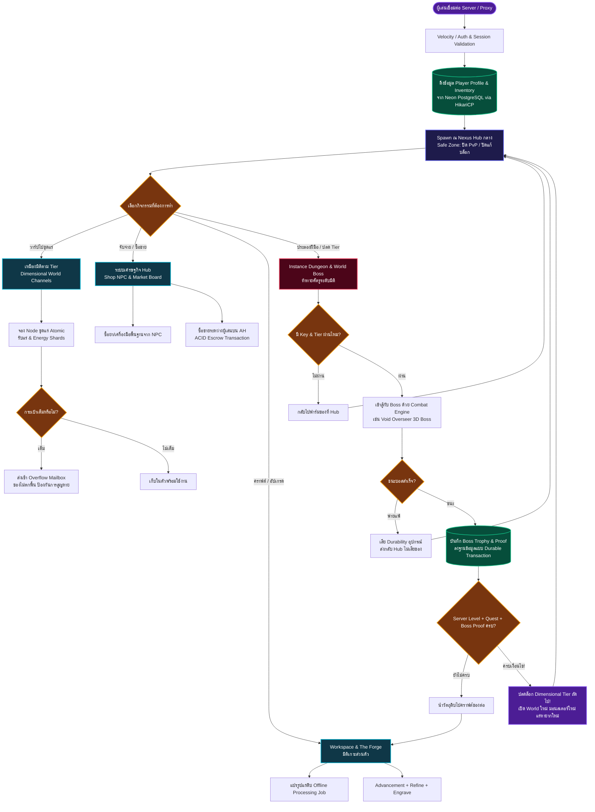
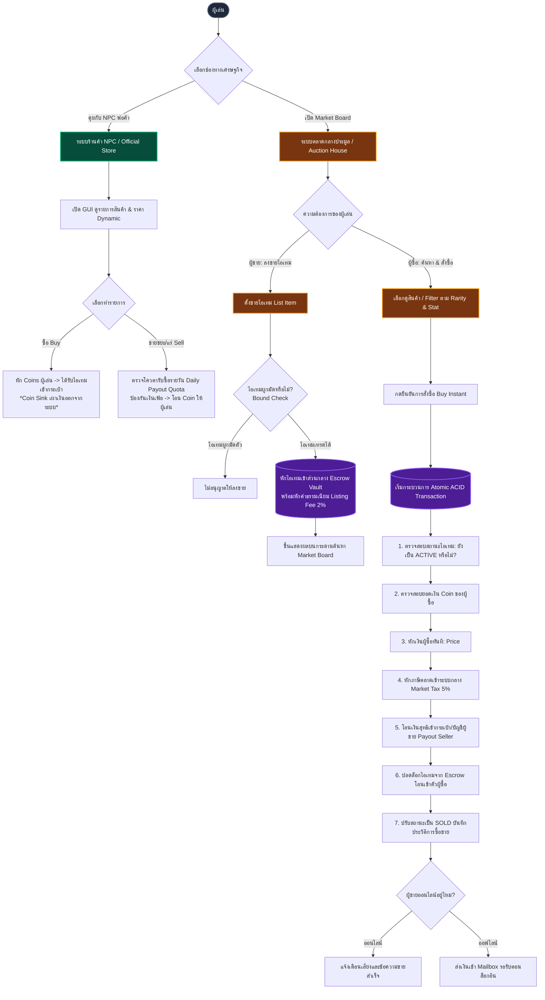
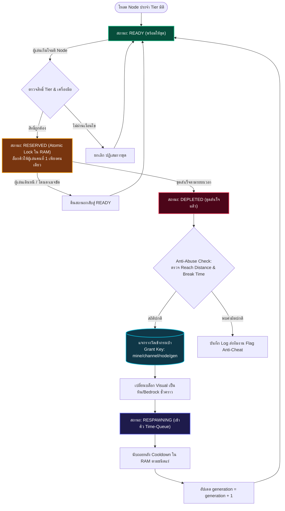
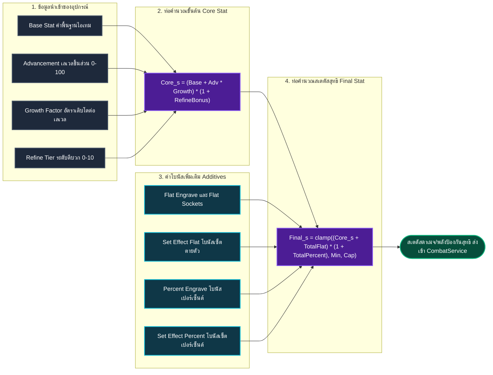
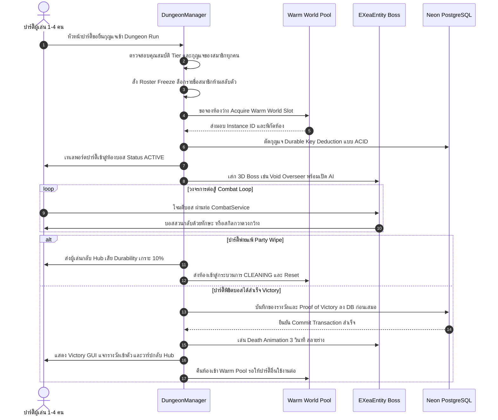
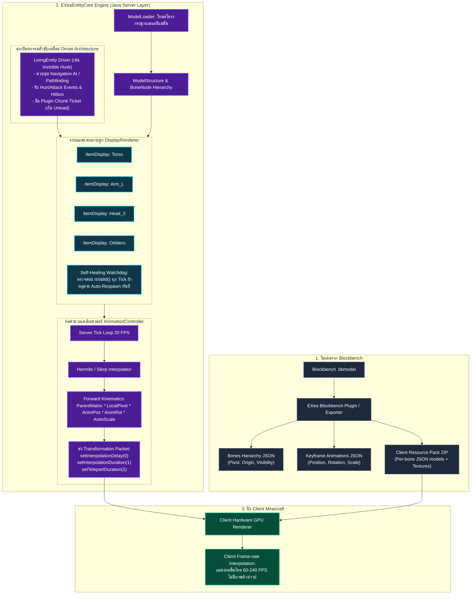

# 🌐 Dimensional Miner — Game Loop & Server Architecture Specification

> **เอกสารอธิบาย Game Loop และสถาปัตยกรรม Java Core Engine**  
> จัดทำสำหรับทีมพัฒนา Dimensional Miner Core & EXea Entity Engine  
> **Interactive Presentation (Local Web):** [http://localhost:8083/p/game-loop-flowcharts/](http://localhost:8083/p/game-loop-flowcharts/)

---

## 1. Main Server Game Loop (วงจรชีวิตหลักของผู้เล่น)

---

## 2. ระบบเศรษฐกิจ: Shop NPC & Market Board (AH)

---

## 3. ระบบ Node เหมืองแร่มิติ (Mining Node Lifecycle)

---

## 4. ท่อคำนวณอุปกรณ์และสเตตัส (GearMath Pipeline)

---

## 5. วงจรชีวิต Instance Dungeon & Combat Engine

---

## 6. สถาปัตยกรรม Java Core: 3D Entity & Equipment Display Engine

---

## 7. สถาปัตยกรรมโมเดลอุปกรณ์ 3D (3D Equipment Display Engine Design)

สำหรับการสวมใส่หมวก 3D, ดาบใหญ่ 3D, ปีกมิติ, และอาวุธแบบกำหนดเองบนตัวผู้เล่น:

1. **Player Anchor Strategy (Passenger / Packet Tracking):**
   - ใช้วิธี Spawn `ItemDisplay` แล้ว Mount หรือ Anchor เทียบพิกัดกับ `player.getEyeLocation()`
   - ไม่ต้องส่ง Packet หมุนทุกองศา ให้ฝั่ง Client อาศัย Interpolation ของตัวผู้เล่น
2. **Lifecycle & Anti-Desync Safeguards:**
   - ดักจับ `PlayerRespawnEvent`, `PlayerChangedWorldEvent`, และ `PlayerQuitEvent`
   - เมื่อผู้เล่นตายหรือเปลี่ยนโลก ให้ทำลาย Display ทันที และ Spawn เชื่อมโยงใหม่เมื่อถึงจุดหมาย
3. **Zero-Lag Network Culling:**
   - ผู้เล่นที่อยู่ห่างเกิน 32 บล็อก จะไม่ได้รับ Packet อัปเดต Matrix ของโมเดลอุปกรณ์คนอื่น ช่วยรักษา TPS เซิร์ฟเวอร์ให้อยู่ที่ 20.0
